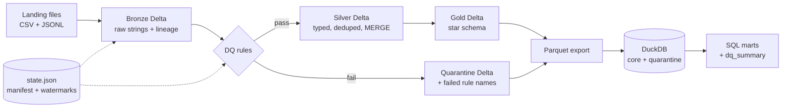
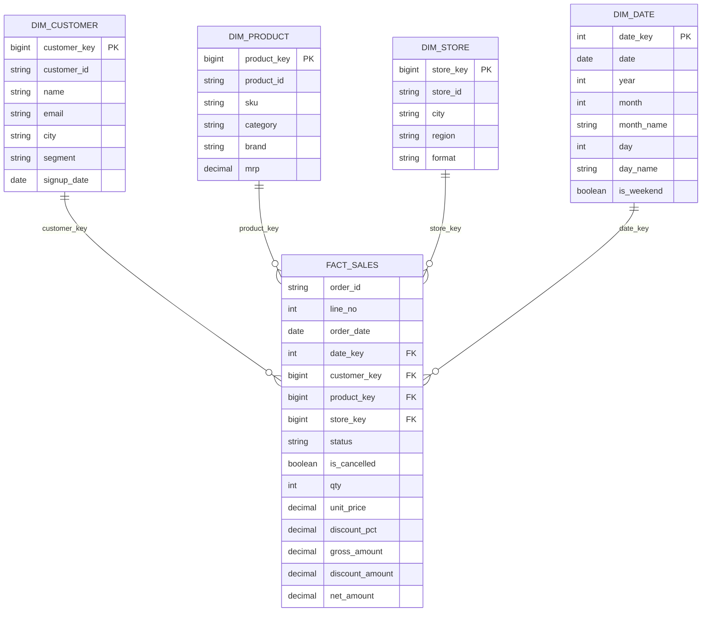

# claude-ganit-retail-etl

A hands-on **data engineering practice project** that mirrors the stack and flow of a modern consulting
data-platform engagement: a **PySpark + Delta Lake medallion pipeline**, a **SQL warehouse with marts**,
**data-quality quarantine**, **orchestration** and **CI** — all running locally on free tools.

It was built to help a new data engineer at Ganit Inc. get comfortable with the typical stack before day one.
Company background and how this project maps to it: [docs/ganit-analysis.md](docs/ganit-analysis.md).

> **Status:** the code is complete for the scope below. The data generator and its tests were run;
> the Spark/Delta/DuckDB stages were written carefully but not executed in the environment where the project
> was authored, so the first real run on your machine may need small fixes. The CI workflow runs an
> end-to-end smoke test on every push, which will surface any problem.

---

## 1. The scenario

A fictional retailer has stores across India. Its source systems drop files into a landing zone:

| Source | Format | Notes |
|---|---|---|
| Customers | CSV snapshot | mixed date formats, duplicates, malformed/missing emails, stray whitespace and casing |
| Products | CSV | category casing inconsistencies |
| Stores | CSV | small reference data |
| Orders | JSON lines, one file per day, nested line items | duplicate deliveries, bad timestamps, missing customer, negative quantities, unknown products, discounts over 100%, and **status changes for yesterday's orders arriving a day late** |

The pipeline ingests these, cleans and validates them, builds a star schema, loads a warehouse, and produces
business-ready marts. The problems above are injected on purpose, because handling them is most of the real job.

## 2. Architecture

```
 generate_data.py        bronze.py            silver.py              gold.py              warehouse.py
 ┌───────────────┐   ┌───────────────┐   ┌──────────────────┐   ┌────────────────┐   ┌───────────────────┐
 │ data/landing  │   │ Delta         │   │ Delta            │   │ Delta          │   │ DuckDB file       │
 │  customers    │──▶│ raw strings   │──▶│ typed, cleaned,  │──▶│ star schema    │──▶│ core.*  (gold)    │
 │  products     │   │ + lineage     │   │ de-duplicated,   │   │ dim_* + fact   │   │ quarantine.*      │
 │  stores       │   │ append-only   │   │ MERGE upserts    │   │ surrogate keys │   │ marts.* (SQL)     │
 │  orders/dt=*  │   │ file manifest │   │ DQ → quarantine  │   │ + parquet      │   │ + dq_summary      │
 └───────────────┘   └───────────────┘   └──────────────────┘   └────────────────┘   └───────────────────┘
        ▲                    state.py (JSON): ingested files + per-entity watermarks            │
        └──────────── pipeline.py CLI  /  orchestration/airflow_dag.py  ──────────────────────┘
```

Free-tool stand-ins for common cloud pieces:

| Real project | Here |
|---|---|
| ADLS Gen2 / S3 / GCS | local folders in `data/` |
| Azure Data Factory metadata-driven copy | `config/pipeline.yaml` + manifest of ingested files |
| Databricks, PySpark, Delta Lake | local PySpark + `delta-spark` |
| Snowflake / BigQuery / Synapse | DuckDB |
| dbt / Dataform models | versioned SQL in `sql/marts/` |
| Great Expectations / dbt tests | `dq.py` rules + quarantine tables |
| ADF triggers / Airflow | `pipeline.py` CLI and an optional Airflow DAG |
| Azure DevOps pipelines | GitHub Actions |

### 2.1 Pipeline flow (Mermaid, renders on GitHub)



### 2.2 Gold data model (star schema)

One fact table at **order-line grain** (one row per item on an order) surrounded by four dimensions.
Dimension keys are deterministic `xxhash64` hashes of the business ID. `dim_customer` also contains an
**unknown member** row (`customer_key = -1`) so facts with an unmatched customer are kept, not dropped.



| Table | Grain | Built from | Notes |
|---|---|---|---|
| `fact_sales` | one order line | silver `order_items` joined to silver `orders` | `gross = qty x unit_price`, `discount = gross x discount_pct / 100`, `net = gross - discount`; cancelled orders are kept and flagged |
| `dim_customer` | one customer | silver `customers` + unknown member | `customer_key = -1` is "Unknown" |
| `dim_product` | one product | silver `products` | category is title-cased in silver |
| `dim_store` | one store | silver `stores` | |
| `dim_date` | one calendar day | min to max order date | weekend flag, month and day names |

Warehouse tables are the same names under the `core` schema. Silver rejects live in the `quarantine` schema and the
reports in `marts`.

## 3. What each layer does

### Generate (`generate_data.py`)
Standard-library only and deterministic for a given seed. Writes the landing files described in section 1.
Roughly 2% of orders are delivered twice, 5% of the previous day's orders get a status update, and a few
percent of fields are deliberately broken.

### Bronze (`bronze.py`)
- Reads only files not seen before (manifest of `relative path | size` in `data/lake/_state/state.json`).
- Keeps **everything as strings** and does no cleaning. Orders use an explicit schema with nested items.
- Adds lineage columns: `_ingest_ts`, `_source_file`, `_batch_id` (a sortable timestamp string).
- Appends to Delta, so bronze is a faithful, replayable history.

### Silver (`silver.py`)
For each entity, only batches newer than the stored watermark are processed:
1. **Clean and cast**: trim, blank-to-null, case normalisation, multi-format date parsing, decimals and ints.
2. **Validate** with declarative rules (`dq.py`). Failing rows go to `silver/_quarantine/<entity>` with the list
   of rules they broke (`_dq_failed`).
3. **De-duplicate** with a window function, keeping the latest version (orders: by `updated_at`, then batch).
4. **MERGE** into the Delta table (`delta_utils.upsert`). Orders and items use a stale-update guard
   (`s.updated_at >= t.updated_at`) so an old record can never overwrite a newer one.

Orders are split into `orders` (header) and `order_items` (one row per line, via `posexplode`).
Items are also checked against the product master (`product_exists`).

| Entity | Rules |
|---|---|
| customers | customer_id_present, signup_date_valid, email_format (missing email allowed) |
| products | product_id_present, mrp_positive |
| stores | store_id_present |
| orders | order_id_present, customer_id_present, store_id_present, order_ts_valid, updated_at_valid, status_valid |
| order_items | product_id_present, product_exists, qty_positive, unit_price_non_negative, discount_in_range |

### Gold (`gold.py`)
A star schema written as Delta, then exported to parquet for the warehouse load:
- `dim_customer` (includes an **unknown member** row, key -1, for orders whose customer is not in the master),
  `dim_product`, `dim_store`, `dim_date`.
- `fact_sales` at order-line grain with gross, discount and net amounts and an `is_cancelled` flag.
- Surrogate keys are deterministic `xxhash64` of the natural key, so reruns produce identical keys.

### Warehouse and marts (`warehouse.py`, `sql/marts/`)
Parquet snapshots are loaded into DuckDB schemas `core` (gold) and `quarantine`. The SQL files then build
`marts`, in filename order:
- `daily_sales`: orders, units, gross, discounts, net, average order value, 7-day moving average.
- `category_performance`: monthly sales per category, discount rate, rank within the month.
- `customer_value`: orders, net sales, recency, and RFM quartile scores (`NTILE`).
- `dq_summary`: how many rows were quarantined, per entity and rule (built dynamically in Python).

### Orchestration (`pipeline.py`, `orchestration/airflow_dag.py`)
The CLI runs stages in dependency order. The optional Airflow DAG calls the same CLI per stage.

## 4. Requirements (all free)

- Python **3.10–3.12** (PySpark 3.5 does not support 3.13)
- Java **17**
- Internet on the first run only (Spark downloads the Delta jars from Maven)
- Windows: use WSL2

## 5. Run it

```bash
git clone https://github.com/yashwanthhari/claude-ganit-retail-etl.git
cd claude-ganit-retail-etl
python3.11 -m venv .venv && source .venv/bin/activate
pip install -e ".[dev]"

python -m lakehouse.pipeline            # all stages
```

First run takes a few minutes. A smaller run: `python -m lakehouse.pipeline --days 3 --orders-per-day 100`.

Run chosen stages: `python -m lakehouse.pipeline silver gold warehouse`
Stages: `generate bronze silver gold warehouse report`. Shortcuts are in the `Makefile`.

### Look at the results

```bash
python - <<'PY'
import duckdb
con = duckdb.connect("data/warehouse/retail.duckdb", read_only=True)
con.sql("SELECT * FROM marts.dq_summary").show()
con.sql("SELECT * FROM marts.daily_sales ORDER BY order_date DESC LIMIT 7").show()
PY
```

In a PySpark shell: `spark.read.format("delta").load("data/lake/silver/orders")` and
``DESCRIBE HISTORY delta.`data/lake/silver/orders` `` to see Delta's version log.

### Tests

```bash
pytest -q
```
- `test_generator.py`: pure Python (files, determinism, injected problems).
- `test_marts_sql.py`: DuckDB only; builds a tiny star schema and checks the three marts.
- `test_dq_and_silver.py`: local Spark; DQ rule splitting, customer cleaning, MERGE with the stale guard.
Spark tests skip themselves if PySpark is not installed.

## 6. Project layout

```
config/pipeline.yaml          paths, data size, Spark settings
src/lakehouse/
  generate_data.py            synthetic messy source data
  bronze.py  silver.py  gold.py  warehouse.py
  dq.py                       rule definitions and quarantine split
  delta_utils.py              MERGE / overwrite / append helpers
  state.py                    manifest + watermark store
  spark_session.py            local Spark + Delta session
  pipeline.py                 CLI
sql/marts/                    warehouse SQL models
sql/legacy/                   T-SQL stored procedure used as a migration exercise
orchestration/                optional Airflow DAG
tests/                        pytest
docs/                         ganit-analysis.md, exercises.md
.github/workflows/ci.yml      tests + end-to-end smoke run
```

## 7. Design decisions

Decisions made while building this project, with the reason and the trade-off.

| # | Decision | Why | Trade-off / alternative |
|---|---|---|---|
| 1 | **Medallion layers** (bronze, silver, gold) | Separates raw history, cleaned data and business models; each layer can be rebuilt from the one before | More storage and more steps than a single ETL script |
| 2 | **PySpark + Delta Lake locally** | Same APIs as Databricks, so the skills transfer; Delta gives MERGE, history and time travel | Needs Java and a Maven jar download on first run |
| 3 | **Bronze keeps everything as strings, append-only** | A bad value can never make ingestion fail, and raw history is replayable | Typing and cleaning are pushed to silver |
| 4 | **Explicit schema for order JSON** | Stable, predictable reads; no surprises from schema inference | New source fields need a schema change |
| 5 | **Manifest of ingested files** (file path + size) in `state.json` | Re-runs never load a file twice (metadata-driven ingestion, like ADF) | A file rewritten with the same size would be skipped; a real platform would use a control table or checksums |
| 6 | **Silver watermark on `_batch_id`** | Each run processes only new bronze batches; the batch id is a sortable timestamp string, so no timestamp-timezone pitfalls | Two batches in the same microsecond would collide (practically impossible here) |
| 7 | **Declarative DQ rules + quarantine** | Nothing is silently dropped, every rejected row says which rule it broke, and quality is measurable (`dq_summary`) | Rules are Python, not a separate tool like Great Expectations or dbt tests |
| 8 | **DQ runs before de-duplication** | A null key can never be collapsed into one "winner" row and lost | An invalid older duplicate also lands in quarantine |
| 9 | **De-duplicate with a window function** (latest `updated_at`, then batch) | Late status updates win over earlier versions | Needs a reliable `updated_at` from the source |
| 10 | **MERGE upserts with a stale-update guard** (`s.updated_at >= t.updated_at`) | Idempotent loads; an old record can never overwrite a newer one | If a re-sent order has fewer lines, the extra old lines are not deleted |
| 11 | **Orders split into header + `order_items`** (`posexplode`) | Gives a clean line-level grain for the fact table | Items for a quarantined header are not processed |
| 12 | **Product existence checked in silver** | Orphan items are caught early, before they reach the fact table | Requires products to load before orders (enforced by stage order) |
| 13 | **Deterministic surrogate keys** (`xxhash64`) | Rebuilds produce identical keys; no lookup tables or sequences needed | Tiny theoretical collision risk; not human-readable |
| 14 | **Unknown member row** in `dim_customer` | Orders with an unmatched customer still count in totals | Only customers get one, because products and stores are validated in silver |
| 15 | **Gold rebuilt with full overwrite** | Simple and correct at this size | Not incremental; real projects would partition or merge |
| 16 | **Gold exported as parquet, then loaded into DuckDB** | DuckDB reads parquet natively; avoids installing a Delta extension (needs network) | An extra export step and storage copy |
| 17 | **DuckDB as the warehouse** | Free, zero setup, SQL dialect close to Snowflake/BigQuery | Single-process, no concurrency or access control |
| 18 | **Marts as plain `.sql` files run in filename order** | Version-controlled, reviewable SQL (the dbt/Dataform habit) without needing dbt | No dependency graph or built-in tests; porting to dbt is an exercise |
| 19 | **`dq_summary` built in Python** | It must union whichever quarantine tables exist | Slightly harder to read than a static SQL file |
| 20 | **`timeParserPolicy=CORRECTED`, session time zone UTC** | Unparseable dates become NULL (so DQ catches them) instead of raising; results are the same on any machine | Hides parser changes between Spark versions |
| 21 | **Pinned PySpark 3.5.3, delta-spark 3.2.1, Python below 3.13** | Known compatible versions | Needs Python 3.10-3.12 and Java 17; upgrade to Spark 4 later |
| 22 | **CLI as the main orchestrator; Airflow DAG optional** | One code path for local runs, CI and Airflow; no heavy setup | Airflow DAG is not covered by CI |
| 23 | **Deterministic synthetic data generator** (standard library only) | Reproducible bugs and tests; no external data downloads | Problems are artificial, so real data will surprise you more |
| 24 | **GitHub Actions CI** (unit tests + small end-to-end run) | Mirrors a client CI/CD pipeline (Azure DevOps equivalent) and catches Spark problems early | Spark start-up makes the run take a few minutes |

### Known limitations

- No slowly changing dimensions (customer city or segment changes overwrite history); see exercise 5.
- Gold is rebuilt in full each run rather than incrementally.
- State is a JSON file, not a control table; fine for one machine, not for concurrent runs.
- The Spark, Delta and DuckDB stages were not executed in the environment where the code was written; the CI
  smoke run is the first real check.
- No cloud-specific pieces (Unity Catalog, IAM, secrets, cluster sizing).

## 8. Where to go next

Work through [docs/exercises.md](docs/exercises.md): idempotency proof, late-arriving data, new DQ rules, SCD2,
migrating the stored procedure to Spark, Delta `OPTIMIZE`/time travel, dbt, Airflow, Structured Streaming,
and mapping this lab to Azure and GCP services.

## 9. Troubleshooting

- `JAVA_HOME is not set` or `Unsupported class file major version`: use Java 17.
- `ModuleNotFoundError: delta`: reinstall with `pip install -e ".[dev]"` inside the virtualenv.
- Out-of-memory: lower `generator.orders_per_day` or raise `spark.driver_memory` in `config/pipeline.yaml`.
- Start clean: `make clean` or delete `data/`.
